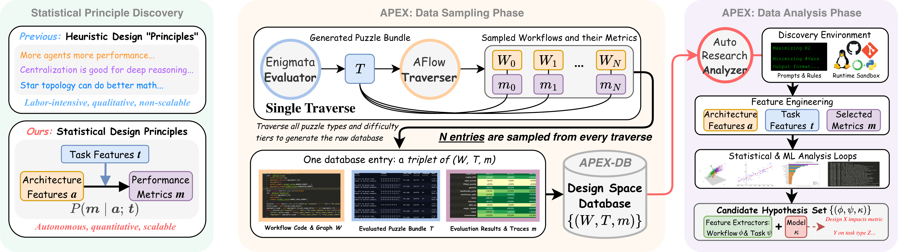

<div align="center">
  
  <br>
  <br>
  <h1> ⛰️ On the Design Space of Agentic System Architectures </h1>
</div>

Large Language Model (LLM) agentic systems have demonstrated immense potential in complex applications. Yet, their architectural design, including multi-agent topologies, orchestration strategies, and prompting cycles, remains largely heuristic.
To address this, we introduce the **Statistical Principle Discovery (SPD)** framework, where we model the relationship between architecture properties **a**, task characteristics **t**, and performance metrics **m** as correlations *P*(**m** | **a**; **t**).
To ensure its statistical soundness, we analyze the three structural biases inherent in SPD from the view of causal inference — *confounding*, *measurement bias*, and *selection bias* — based on which we derive the **APEX** (**A**rchitectural **P**rinciple **EX**ploration) system from first principles. APEX is an end-to-end autonomous, scalable system that operationalizes this framework via a two-phase discovery pipeline:

1. **Data sampling phase** — produces a large-scale **APEX-DB** of over 28K architecture-task-performance triplets, via a *Traverser* that repurposes the AFlow automatic agent optimizer to sample architecture designs across tasks of different types and difficulties, scored by a controlled, noise-free *Evaluator* based on the Enigmata synthetic puzzle generator.
2. **Data analysis phase** — applies an AutoResearch-based *Analyzer* to autonomously discover a parsimonious *candidate hypothesis set*, deriving design principles that demonstrate APEX's discovery capability across a three-tier validation ladder: rediscovering established heuristics, surfacing novel within-grain laws not yet formalized in the literature, and exploring high-dimensional details beyond typical human intuitions.

# Installation

**1. Clone the repo** — assume it's under your home directory `~`.

**2. Set up the environment**

```shell
export OPENAI_API_KEY=YOURKEY
export DATA_DIR=data/                 # change to a directory you like
export EXP_RESULTS_DIR=apex_outputs   # change to a directory you like
export EXP_LOGS_DIR=apex_logs         # change to a directory you like
```

**3. Install the requirements**

As a one-liner:

```shell
conda create -y --name apex python=3.9 && conda activate apex && pip install -r requirements.txt
```

Or step by step — create a conda env named `apex` with Python 3.9:

```shell
conda create -y --name apex python=3.9
```

Activate it:

```shell
conda activate apex
```

Install the requirements:

```shell
pip install -r requirements.txt
```

**4. Initialize the submodules** — Enigmata is loaded as a submodule and used for its verifiers.

```shell
git submodule update --init --recursive
```

**5. Extract the puzzles**

```shell
unzip data.zip
```

# Workflow Viewer (apex-viewer)

We provide an app to browse the ~28k pre-generated designs — filter and sort by stats, and read-only inspect each design's `graph.py` / `prompt.py`. It reads the corpus from `all_workflows.jsonl`. Full docs: [apex-viewer/README.md](./apex-viewer/README.md).

First extract the corpus:

```shell
unzip all_workflows.zip
```

**Run locally** (dev server with hot reload):

```shell
cd apex-viewer
npm install
npm run export
npm run dev
```

The following prepare the data
```shell
npm run export      # all_workflows.jsonl -> public/data/  (auto-finds ../all_workflows.jsonl)
```

The following starts the viewer on http://localhost:5173
```shell
npm run dev
```

**Serve it in a container** (nginx on port 8080). The data is baked into the image at build time from `all_workflows.zip`, so the image is **self-contained — it runs with no flags or volumes** (which is what Skiff needs). Build from the repo root so the corpus zip is in the build context:

```shell
docker build -f apex-viewer/Dockerfile -t apex-viewer .
docker run --rm -p 8080:8080 apex-viewer        # http://localhost:8080
```

To swap data without rebuilding, optionally mount a JSONL to override the baked copy:
`-v "$PWD/all_workflows.jsonl:/data/all_workflows.jsonl:ro"`.

**Deploy on Skiff:** see [apex-viewer/README.md](./apex-viewer/README.md#deploy-on-skiff).

# Workflow search

We modified the API key resolution from AFlow to read the API key from the environment rather than from the `config2.yaml` file. To add an OpenAI model, adapt your configuration file in [thirdparty/aflow/config/config2.yaml](./thirdparty/aflow/config/config2.yaml) (following the format in [thirdparty/aflow/config/config2.example.yaml](./thirdparty/aflow/config/config2.example.yaml)):

```yaml
 "gpt-5.4-mini":
   api_type: "openai"
   base_url: "https://api.openai.com/v1"
   api_key: $OPENAI_API_KEY
```

Then you can search using the following pattern:

```shell
python search.py --dataset EnigmataMagicSquare --bundle_id 0 --run_ndx 4 --opt_model_name gpt-5.4 --opt_temperature 0.0 --worker_model gpt-5.4-nano --worker_temperature 0.0 --aggregator_model gpt-5.4-mini --aggregator_temperature 0.0
```

Core parameters to consider:

```shell
  --dataset                 # (str)   Name of the dataset
  --bundle_id               # (int)   Difficulty bundle (0, 2, 4)
  --run_ndx                 # (int)   Search index to separate runs using the same parameters
  --opt_model_name          # (str)   Model used as the workflow optimizer
  --opt_temperature         # (float) Temperature of the optimizer model
  --worker_model            # (str)   Model used as the worker
  --worker_temperature      # (float) Temperature of the worker model
  --aggregator_model        # (str)   Name of the model used as aggregator
  --aggregator_temperature  # (float) Temperature of the aggregator
```

Some additional parameters to consider:

```shell
  --overwrite               # Overwrite a previous experiment and restart it
  --wandb_project           # (str) Enable wandb tracking with a specific project
  --weave                   # Enable LLM call tracking via Weave
```

## Run the search in Docker

Build the `apex` image (Python 3.9 + Node 22 + APEX deps; puzzle data is baked from `data.zip` at build time):

```shell
docker build -t apex .
```

Run a search — the API key and config are provided at runtime, never baked into the image:

```shell
docker run --rm -it \
  -e OPENAI_API_KEY=sk-... \
  -v "$PWD/config2.yaml:/app/config2.yaml" \
  -v "$PWD/apex_outputs:/app/apex_outputs" \
  -v "$PWD/apex_logs:/app/apex_logs" \
  apex \
  python search.py --dataset EnigmataSudoku --bundle_id 0 \
    --opt_temperature 0 --worker_temperature 0 --aggregator_temperature 0
```

The search is a batch CLI, not a web service.

# Acknowledgments

We would like to thank the authors of AFlow and Enigmata for releasing their code.

<!-- ## Citing -->

<!-- ```bibtex
@misc{TODO
      title={On the Design Space of Agentic System Architectures},
      author={Xavier Cadet and Junyan Cheng and Peter Chin and Kyle Richardson},
      year={2026},
      eprint={TODO},
      archivePrefix={arXiv},
      primaryClass={cs.AI},
      url={TODO},
} -->
